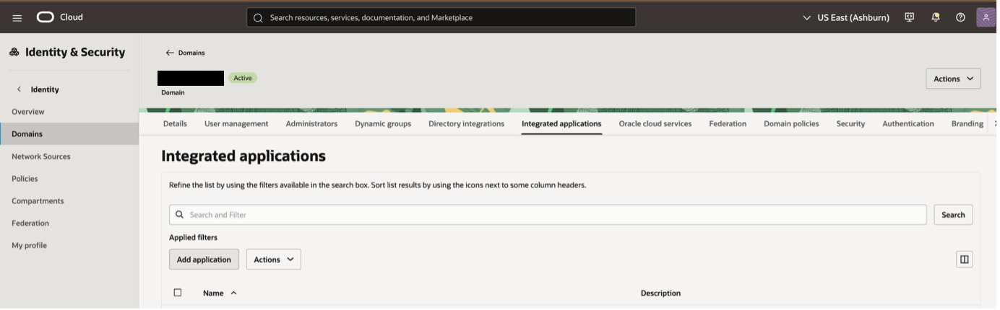
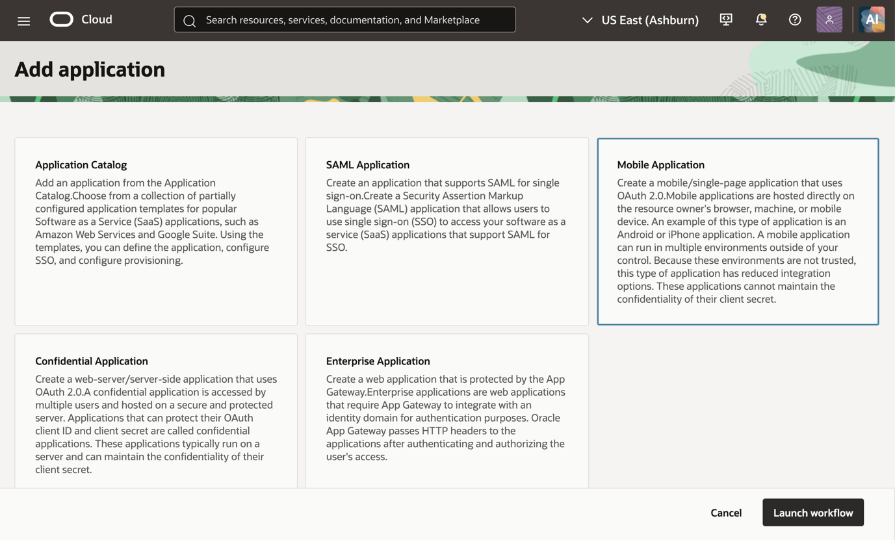
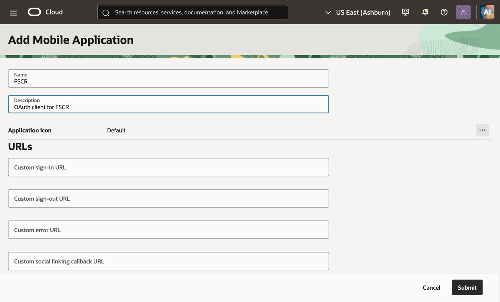
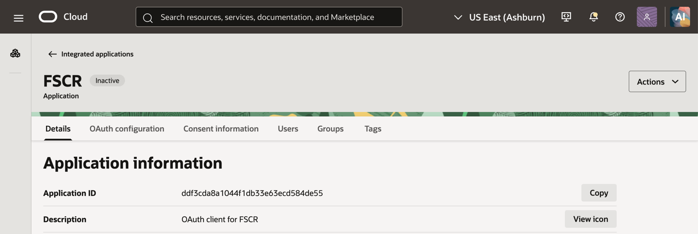
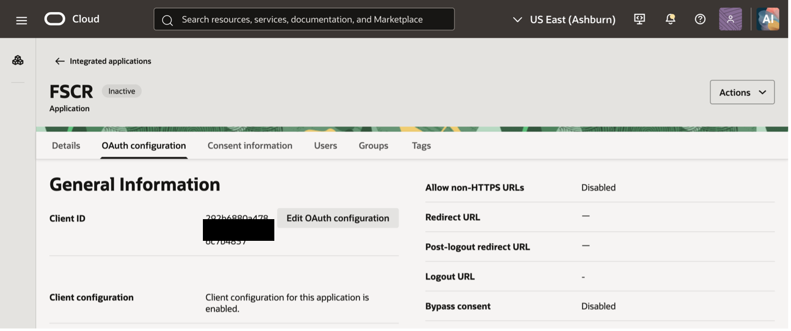
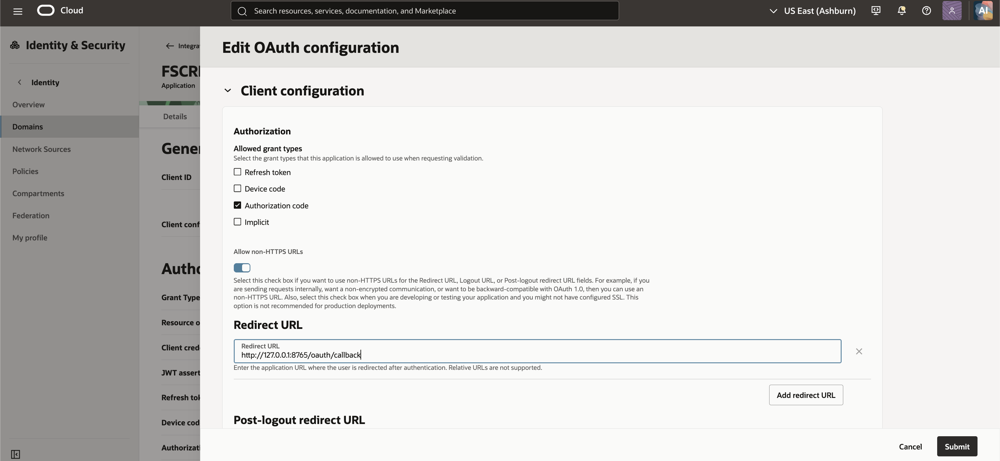
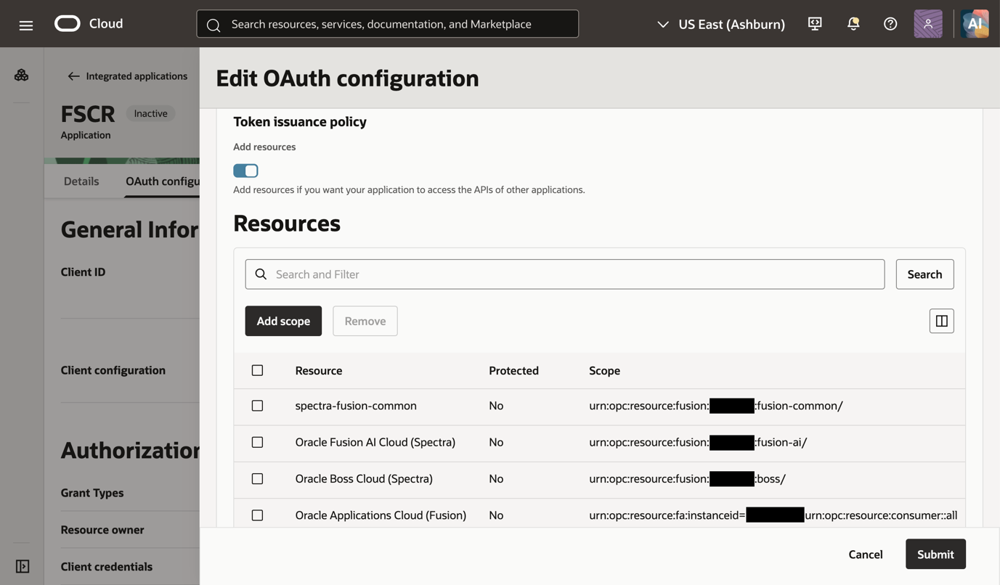
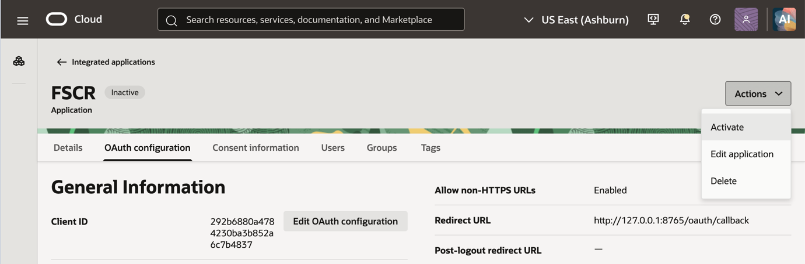

# OAuth client setup for FSCR 26D

Use the [26D OAuth setup document](../assets/oauth-setup-fscr-26d.docx) and these
steps to guide IAM client setup and `core/auth/fusionEnv.properties` configuration.
Show the relevant screenshots as you explain each step. The user or Identity Domain
administrator performs the console actions; source instructions do not authorize
agent execution or bypass the active workflow.

## 1. Select the Fusion Applications Identity Domain

Sign in to OCI IAM as an Identity Administrator. Navigate to **Identity & Security
> Domains**, open the Identity Domain associated with the intended Fusion
Applications instance, and select **Integrated applications**. Click **Add
application**.



## 2. Create a Mobile Application

Select **Mobile Application** and click **Launch workflow**. This is the
public-client route used with FSCR's default PKCE login.



Enter a name and description, for example the document's `FSCR` and `OAuth client
for FSCR`. The name is a display label, not the OAuth Client ID. The source says
no other entries are required on this page apart from the optional access
restriction below. Click **Submit**.



### Optional restriction to assigned users or groups

Enable **Enforce grants as authorization** only when access should be restricted
to specific users or groups. If enabled, add the intended FSCR users or groups
through the application's **Users** or **Groups** tab after submitting. Without
those assignments, their FSCR login will not work. This optional flag is described
in the document's text; it is not visible in the supplied application-details
screenshot. IAM application assignments do not replace Fusion roles or data access.

## 3. Open OAuth configuration

Open the created application and select **OAuth configuration**. The application
**Details** tab displays an Application ID; do not use that value for `clientId`.
Obtain the OAuth Client ID from **OAuth configuration > General Information**.



Click **Edit OAuth configuration**.



## 4. Configure authorization code and callback

Enable the **Authorization code** grant type. Enable **Allow non-HTTPS URLs** for
the documented local callback listener and register exactly:

```text
http://127.0.0.1:8765/oauth/callback
```

Use the same value for `redirectUrl` in the local properties file. The HTTP setting
applies to this loopback callback; the Fusion origin and identity endpoints use
HTTPS. Do not enable unrelated grant types merely because they are shown.



## 5. Add resource scopes

In **Token issuance policy**, enable **Add resources**. Use **Add scope** to add
these resource scopes from the selected Fusion Applications environment:

| Resource named in the 26D document | Property |
| --- | --- |
| Oracle Applications Cloud (Fusion) | `scope` |
| Oracle Fusion AI Cloud (Spectra) | `ai_scope` |
| Oracle Boss Cloud (Spectra) | `boss_scope` |
| spectra-fusion-common | `fusion_common_scope` |

The document also lists optional product scopes to add when the implementation
requires them:

| Optional resource | Property |
| --- | --- |
| Risk Cloud | `rmc_scope` |
| spectra-knowledge-management | `km_scope` |
| CPQ | `cpq_scope` |
| Oracle Fusion Field Service | `fs_scope` |
| Oracle Unity | `cdp_scope` |

Record the exact environment-specific values in the resource table, then click
**Submit**. Do not reconstruct a scope from a pod name or copy identifiers from a
screenshot. Each login uses the selected service's scope, not every listed scope.



## 6. Activate and record the Client ID

Choose **Actions > Activate** and record your application's OAuth Client ID.
The screenshot shows where to activate while the status is still **Inactive**;
verify the resulting active status before attempting login.



## 7. Configure fusionEnv.properties

Populate `core/auth/fusionEnv.properties` using the selected environment's values.
The 26D document provides this configuration as text, not a screenshot. The
following synthetic example preserves its property names:

```properties
environment=YOUR_FUSION_ENVIRONMENT_NAME
restBaseUrl=https://fusion.example.invalid
clientId=YOUR_IAM_MOBILE_APPLICATION_CLIENT_ID
redirectUrl=http://127.0.0.1:8765/oauth/callback
# FSCR scopes: replace each placeholder with the registered value
scope=YOUR_FUSION_SCOPE
ai_scope=YOUR_FUSION_AI_SCOPE
boss_scope=YOUR_BOSS_SCOPE
fusion_common_scope=YOUR_FUSION_COMMON_SCOPE
# Optional services: configure when required by the selected workflow
km_scope=
rmc_scope=
cpq_scope=
fs_restBaseUrl=
fs_scope=
cdp_restBaseUrl=
cdp_scope=
# The source lists this proxy setting; confirm support in the selected client
enableProxy=true
```

Use the Fusion HTTPS base URL including `https://`, with no whitespace, UI route,
or REST resource path. For Field Service or Unity, supply that service's base URL
and scope when needed. The source's sample host strings are illustrative, not
literal values to copy.

The source lists `enableProxy=true` with a comment about Express mode Oracle CDN
proxy support. This entry alone does not establish that a selected client supports
proxy discovery; consult the implementation before recommending proxy changes.
Read the [current property mapping](fusion-environment-configuration.md) for service
selection, PKCE defaults, and the separation of local properties from OAuth trust.
Do not add OAuth endpoint overrides or plaintext secrets to the properties file.

## 8. Test through the authentication workflow

The document's test prompt is **fusion login**. Route that request to
[Fusion OAuth Authentication](../../../auth/fusion-oauth-authentication/SKILL.md)
and follow its declared enrollment, permissions, and browser login steps. On first
use, the user must enroll the Fusion URL, environment name, and OAuth Client ID.
Then complete browser sign-in and wait for the script's successful token-cache
write; a browser callback alone does not prove token acquisition succeeded.

Use [PKCE login and token acquisition](pkce-login-flow.md) for the detailed flow,
commands, cache reuse, and troubleshooting. A login request does not authorize
unrelated Fusion configuration changes. Do not execute this test merely because
it appears in the source document.

## Source and screenshot index

Source: user-provided **OAuth Setup for Oracle Fusion Setup and Configuration
Skills Registry (FSCR) Version 26D**, file
`OAuth Setup for Oracle Fusion Setup and Configuration Skills Registry 26D.docx`.
The bundled document and all eight extracted PNGs preserve the supplied bytes.
Source SHA-256:
`f62d57208b0a476e6d356a4cd7f833ee161bb9c4d92614a44302b9a884706941`.
This source replaces the previous ClientApp guide and its nine-image set.

| Source image | Source context | Reference step |
| --- | --- | --- |
| 1 | Integrated applications | 1 |
| 2 | Add application / Mobile Application | 2 |
| 3 | Application name and description | 2 |
| 4 | Application details and tabs | 3 |
| 5 | Edit OAuth configuration | 3 |
| 6 | Authorization code and callback | 4 |
| 7 | Token issuance policy / resource scopes | 5 |
| 8 | Activate application | 6 |

The screenshots contain source example identifiers, with some values masked.
They are navigation aids, not configuration values for another environment.
The supplied document governs the illustrated IAM setup. The current auth skill
and its code govern enrollment, PKCE, and token handling. The explanatory PKCE
notes and implementation caveats here supplement the document; they are not
claims that those details appear in its screenshots. If source instructions and
current implementation differ, explain the difference rather than silently
changing the authentication route.
