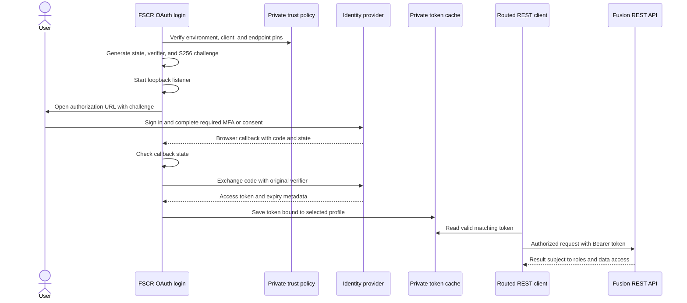

# PKCE login and Fusion REST access tokens

This guide explains the authorization-code flow with PKCE implemented by
[Fusion OAuth Authentication](../../../auth/fusion-oauth-authentication/SKILL.md).
It covers the first enrollment of a Fusion environment, browser login, token
storage, and reuse by Fusion REST clients. PKCE is the default public-client mode
and does not require a client secret.

FSCR initiates the login flow whenever it needs to access Fusion and requires
authentication. You do not need to log in separately before using FSCR. To test
your authentication setup explicitly, enter the prompt **fusion login** in Codex.
This is an optional test prompt, not a required step for normal FSCR use. When a
valid token for the selected context is cached, FSCR can reuse it without another
browser login.

These are instructions for the user and for the routed authentication workflow.
Reading this guide does not execute enrollment or login. The onboarding skill
remains advisory; agents perform external operations only through the selected
OAuth or implementation workflow and its prerequisites.

## 1. Prepare the IAM application and local configuration

Complete the [illustrated IAM application setup](iam-client-application-setup.md):
create and activate the Mobile Application in the Identity Domain associated with
your Fusion instance, enable Authorization code, register the loopback callback,
and add the required resource scopes. If **Enforce grants as authorization** is
enabled, assign the intended FSCR users or groups to the mobile application before
login, as described in the 26D setup guide. The user signing in also needs the Fusion
roles and data access required by the eventual REST operation.

Configure `core/auth/fusionEnv.properties`. This example uses placeholders, not
working environment values:

```properties
environment=MY_FUSION_ENV
restBaseUrl=https://fusion.example.invalid
clientId=YOUR_REGISTERED_CLIENT_ID
redirectUrl=http://127.0.0.1:8765/oauth/callback
pkce=true
scope=YOUR_EXACT_REGISTERED_FUSION_SCOPE
```

Use the Fusion HTTPS origin for `restBaseUrl`, and copy the Client ID and exact
scope from the intended IAM application. Match `redirectUrl` exactly to the
registered URI. `pkce=true` is also the default when the property is absent.
Do not put a client secret, access token, `authorizeUrl`, or `tokenUrl` here.
OAuth endpoints come from the separate private trust policy described below.
See the [property mapping](fusion-environment-configuration.md) for other services.

## 2. Enroll the environment on first use

Enrollment is requested when authentication is first needed. To test the setup
before starting implementation work, enter this optional prompt in Codex:

```text
fusion login
```

Otherwise, continue using FSCR; it will initiate authentication when needed by
the selected Fusion workflow. When `~/.fusionaim/oauth-trust.json` does not exist,
FSCR presents the enrollment prompt:

> FSCR needs to enroll the trusted Fusion Environment
> Please enter the Fusion URL and a name for the environment. Also provide the Oauth Client ID so that an approved environments trust file can be created

Provide these three values together:

| Enrollment input | Must match |
| --- | --- |
| Fusion URL | The Fusion origin configured by `restBaseUrl` |
| Environment name | `environment` |
| Oauth Client ID | `clientId` of the registered application |

No password, client secret, or issuer URL is requested during this first-use
enrollment. FSCR validates the supplied values and discovers the identity issuer
from the Fusion origin's HTTPS login redirects. This discovery makes up to eight
requests within a 30-second window, follows only same-origin redirects, and stops
when an off-origin redirect identifies `/oauth2/v1/authorize`. It does not request
that identity URL during discovery, send credentials or cookies, or use an OpenID
discovery document. Ambiguous redirects, transport failures, or invalid input stop
enrollment without creating trust.

FSCR stores the selected environment's Fusion origin, issuer, approved Client ID,
and OAuth paths in `~/.fusionaim/oauth-trust.json`. The normal paths are
`/oauth2/v1/authorize` and `/oauth2/v1/token`. On POSIX systems, the private directory
uses mode 0700 and the file uses mode 0600; Windows uses the auth implementation's
private-storage controls. This policy is outside the repository and project
workspace. Enrollment establishes which endpoints FSCR trusts; it does not grant
Fusion privileges or obtain an access token. The requested authentication flow
then continues with browser login.

### Agent-assisted enrollment or an additional environment

The agent presents the same welcome prompt, collects the three values, and uses
the auth skill's declared enrollment process. It then continues the pending login
or Fusion workflow using the selected environment's configuration. Enrollment
does not populate `fusionEnv.properties` or acquire a token by itself. If you use
a different environment properties file, identify it to FSCR so the workflow
selects the matching configuration.

The automatic first-use prompt applies only when the entire trust file is absent.
If the file exists but a new environment is not enrolled, ask FSCR to enroll that
environment through the authentication skill. Existing enrollment changes require
deliberate review and explicit replacement; invalid trust files are not silently
replaced. The auth skill also supports independently approved issuer enrollment
for environments whose login
redirects cannot be discovered. Do not guess the issuer, derive trust from arbitrary
OAuth properties, or substitute browser exploration when discovery fails.

## 3. Complete the PKCE browser login

After trust and configuration checks, the current implementation performs these
steps:

1. Generate a random `state` and a one-time PKCE `code_verifier`. Compute
   `code_challenge = BASE64URL(SHA256(code_verifier))` without padding. The verifier
   stays in the login process and is not printed or persisted.
2. Construct the trusted authorization URL with `client_id`, `response_type=code`,
   `redirect_uri`, the selected `scope`, `state`, `code_challenge`, and
   `code_challenge_method=S256`.
3. Bind a temporary local callback listener before opening the browser. With the
   documented callback, it listens on `127.0.0.1:8765`. The default wait is 300
   seconds; the authentication workflow can configure that wait when needed.
4. The user signs in at the identity provider and completes any required MFA or
   consent. An existing SSO session may complete this quickly. Credentials stay in
   the identity provider's browser flow, not in chat or the properties file.
5. The browser returns an authorization code and state to the registered callback.
   FSCR closes the listener, rejects an OAuth error or missing code, and verifies
   that the returned state matches before exchanging the code.
6. FSCR sends a form-encoded POST to the exact trusted token endpoint with
   `grant_type=authorization_code`, `code`, `redirect_uri`, `client_id`, and the
   original `code_verifier`. PKCE mode sends no client secret or client-secret
   Basic authentication header. The identity provider checks the verifier against
   the authorization request's challenge and returns an access token on success.
7. FSCR requires a nonempty `access_token`, saves it in the private cache, and
   reports the cache location and login completion without printing the token.



The browser's “Authorization complete” page only acknowledges receiving a code;
wait for FSCR to confirm login completion to know the exchange and cache write
succeeded. If the workflow cannot open the browser automatically, follow its
instructions to open the authorization URL while the login process waits.
The loopback browser must reach the
machine running that listener; a remote machine's `127.0.0.1` is not your desktop.

For a non-loopback registered redirect, automatic capture is unavailable and the
authentication helper requires a private local input flow. Prefer the documented loopback flow;
do not paste authorization codes or verifiers into chat, logs, or artifacts.
FSCR must retain the original PKCE verifier for the code exchange; a newly
generated verifier cannot redeem a code from an earlier flow.

## 4. Select the token's service and scope

Each login uses one configured service context. A token for standard Fusion REST
does not automatically cover all other services.

| Service selected by the workflow | Base URL property | Scope property |
| --- | --- | --- |
| `standard` (default) | `restBaseUrl` | `scope` |
| `boss` | `restBaseUrl` | `boss_scope` |
| `fusion-common` | `restBaseUrl` | `fusion_common_scope` |
| `field-service` | `fs_restBaseUrl` | `fs_scope` |
| `cdp` | `cdp_restBaseUrl` | `cdp_scope` |

FSCR selects the service required by the operation. For example, a Fusion Common
operation uses `fusion_common_scope` and initiates authentication if a suitable
token is unavailable. When using the optional **fusion login** test prompt,
identify the environment and service you want to test if they are not clear
from context.

A missing or blank selected scope blocks login. Do not substitute a different
scope to get past the check. Fusion AI and optional KM/RMC/CPQ clients have their
own consuming workflows and are not additional entries in this service selector.

## 5. Reuse the token for Fusion REST APIs

The managed cache is `~/.fusionaim/<profile-fingerprint>_token.json`. Its fingerprint
binds the issuer, authorization and token endpoints, client, target service, and
scope. `auto` selects that managed path; it is not a literal filename. Tokens,
verifiers, and codes must not enter tracked files or `project/` artifacts.

When the active workflow reaches an approved REST operation, its existing
[REST client](../../../fusion-api/rest-api-client/SKILL.md) calls the shared auth
helper with the same environment and scope. A matching cached token is reusable
only when it remains valid beyond the 60-second expiry margin. Otherwise, the
helper starts another authorization-code login. The client supplies
`Authorization: Bearer <access token>` internally; users do not need to copy the
token into commands. Destination and service checks apply before credential use.
An access token authenticates the caller; Fusion roles and data access still
determine which operations and records are permitted.

The optional **fusion login** prompt tests authentication explicitly. Normal
FSCR workflows reuse a valid matching cache and initiate login when authentication
is required; running the test prompt first is unnecessary. The current auth helper
does not persist or redeem OAuth refresh tokens: “refresh” here means repeating
the authorization-code flow and replacing the cached access token. Do not promise
unattended renewal from a refresh-token grant.

## Troubleshooting and completion

| Stage or symptom | Next action |
| --- | --- |
| Enrollment values mismatch | Align environment name, Fusion origin, and Client ID with the intended configuration; do not change environments silently. |
| Discovery fails or times out | Report the discovery stage and selected environment; resolve connectivity or use the auth skill's independently approved explicit issuer route. |
| Existing trust rejects login | Review the enrolled client and endpoint pins. Do not delete or replace trust as an automatic workaround. |
| Callback port busy or timeout | Resolve the local port/browser issue and start a fresh login. If changing callback URI, update IAM registration and local configuration together. |
| State mismatch, missing code, or rejected code | Stop that attempt and start a fresh flow. Do not reuse an ambiguous or already exchanged code. |
| Cache write fails | Report login as incomplete; correct private storage permissions/path. Never fall back to a repository-local token file. |
| REST 401 or 403 | The common REST client can reauthenticate once and retry GET/HEAD when no explicit token was supplied. Continued failure needs scope/role/data-access diagnosis. POST/PATCH/DELETE and other mutations must not be replayed without idempotency or explicit approval. |

For a failed durable run, follow the selected workflow's redacted diagnostic
contract: environment, stage, failure class, safe message, and next action.
Do not automatically retry a token exchange after an ambiguous failure.
For success, report the selected service, login completion, and cache location.
Do not claim a Fusion REST operation succeeded until its own workflow validates it.

## Implementation references

This guide reflects repository behavior inspected on 2026-10-08. Recheck these
sources when authentication behavior changes:

- [OAuth skill contract](../../../auth/fusion-oauth-authentication/SKILL.md).
- [Enrollment CLI](../../../auth/fusion-oauth-authentication/scripts/fusion_auth_setup.py):
  trust creation, additional environments, and explicit replacement.
- [Auth helper](../../../auth/fusion-oauth-authentication/scripts/fusion_auth.py):
  `ensure_oauth_trust_policy`, `discover_oauth_issuer`, `login_for_access_token`,
  `wait_for_authorization_code`, `exchange_authorization_code`, and token caching.
- [REST client integration](../../../fusion-api/rest-api-client/scripts/rest_client_common.py):
  cache reuse, request execution, and limited GET/HEAD reauthentication.
